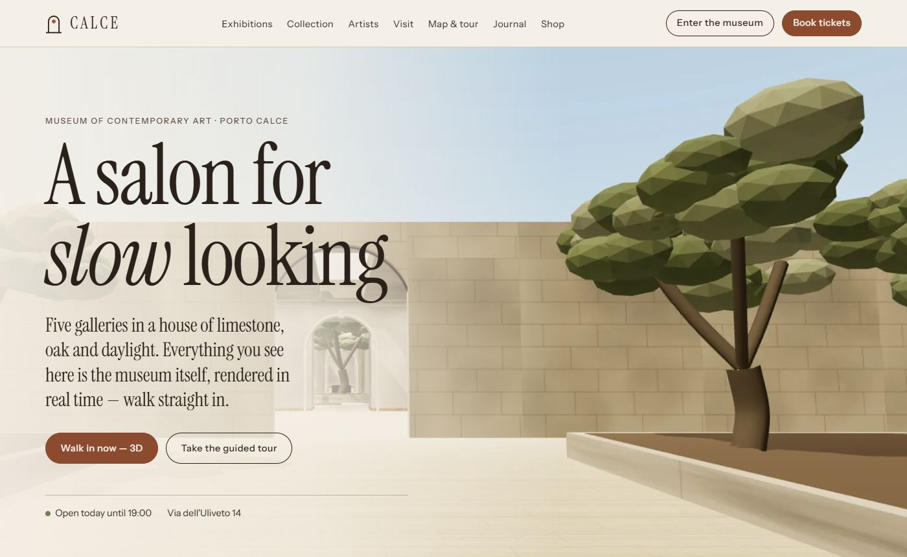
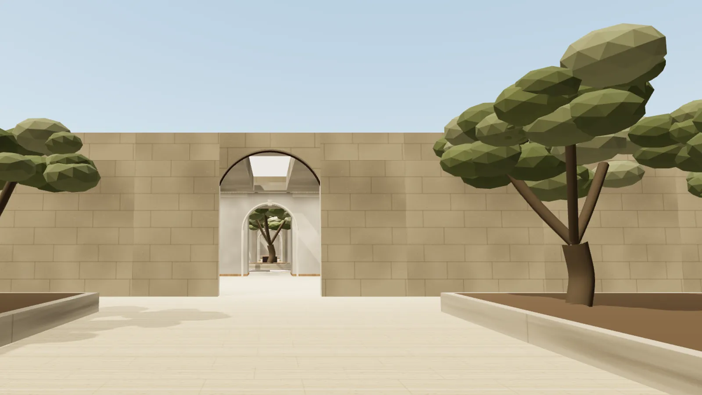
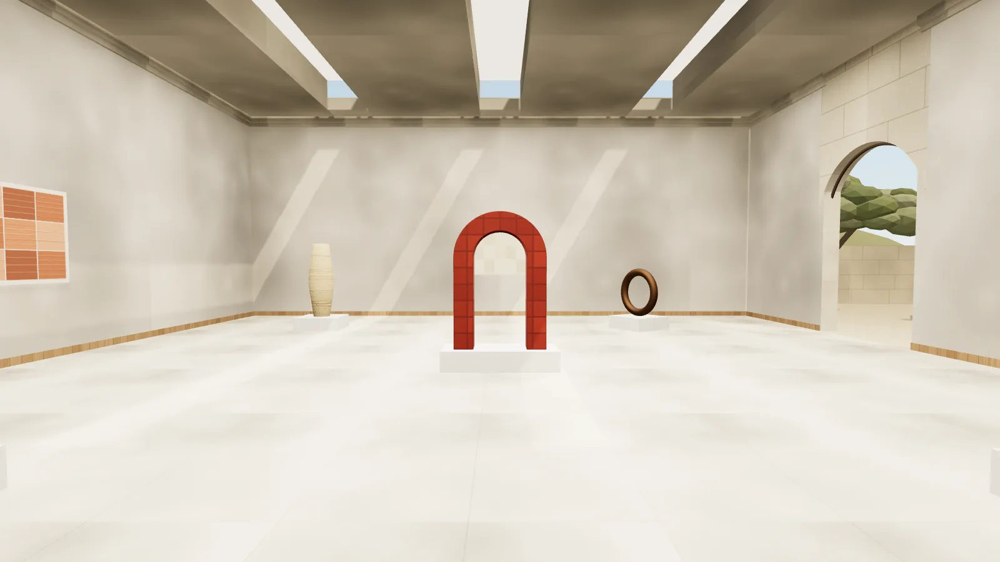
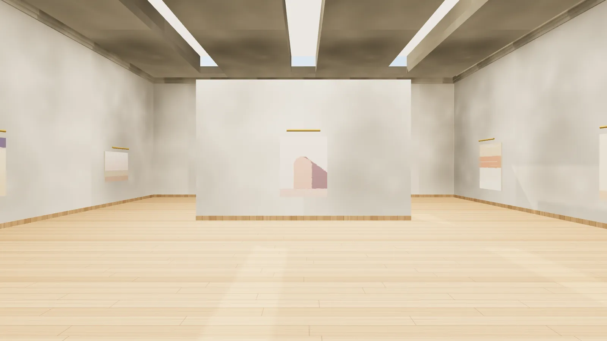
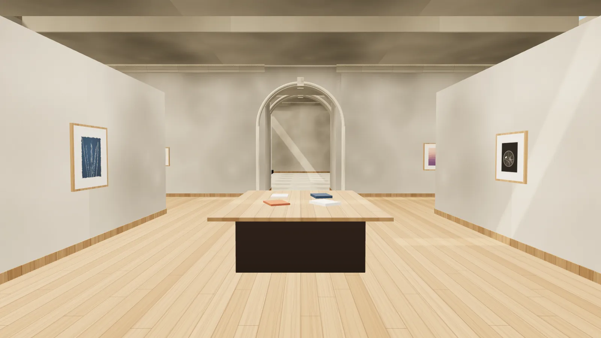
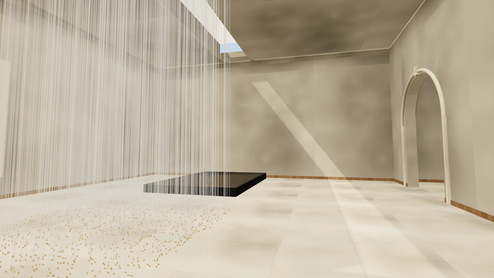
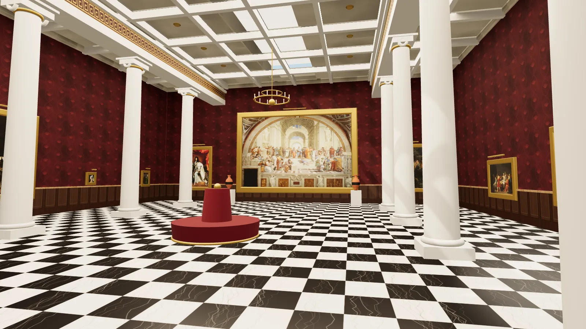

# CALCE — The Cultural Salon

A museum of contemporary art built of limestone, oak and daylight — that exists only online. Walk through
it in real time, room by room, or browse it as a website.

### **[Visit the museum →](https://711nishtha.github.io/calce-museum/)**

---

## Walk in

You arrive in an olive forecourt. A single arched portal leads through the reception hall into a day-lit
atrium, where an olive tree grows under an open oculus. Five galleries open from there.

**[Enter the 3D museum →](https://711nishtha.github.io/calce-museum/museum/)** ·
**[Start the guided tour →](https://711nishtha.github.io/calce-museum/museum/?tour=1)**

## The galleries

### I · The Weight of Stillness — sculpture

Nothing in this room is glued, pinned or bolted. Stacked limestone, bronze cast from fishing nets, a
terracotta arch too narrow to be comfortable. A glazed door opens onto the sculpture garden.

### II · A Grammar of Walls — painting

An argument with the postcard Mediterranean: earth pigments sanded back until they look used, arches
emptied of people, frescoes of cracks and repairs nobody photographs.

### III · Salt & Light — photographs made without a camera

Cyanotypes exposed by the Marseille sun, photograms of glass and water, prints left at the tideline for a
day. A low-lit reading room with the artists' notebooks on the table.

### IV · Rooms That Listen — installation

The most divisive room in the building: 2,400 linen threads that move only because you do, a basin of
still water that mirrors the room, a wall that breathes, and a single line of light in a dark chamber.

### V · The Royal Salon — masterpieces in reproduction

A colonnaded picture gallery of damask, gilt and marble, hung with twelve public-domain paintings —
*The School of Athens*, *Las Meninas*, *The Ambassadors*, the *Mona Lisa*, *The Birth of Venus* and more —
shown as painting as propaganda, from Raphael to David.

## Finding your way

- **Mouse and keyboard** — click to look around; `W A S D` or the arrow keys to walk, `Shift` to walk
  faster, `E` to read about the work in front of you.
- **Keyboard only** — the arrow keys walk and turn; `G` opens a directory of where you are, the ways on
  and every work; `T` starts the guided tour (`N` / `B` for next and previous).
- **Phone or tablet** — drag on the left of the screen to walk, on the right to look.
- **Help and comfort** — press `H` for every control, a *Reduce motion* switch and lighter graphics.
  Room changes and the work you are facing are announced to screen readers.
- **Jump straight in** — every gallery and every work on the website has a link that opens the 3D museum
  standing right there.

## Beyond the galleries

The website carries the same museum in another form: exhibition pages and curators' statements, artist
biographies, a searchable collection of 45 works, an interactive map, a journal (including a critic arguing
against the museum's whole idea), a shop, and a full graphic identity — posters, signage, tickets and
catalogue covers.

---

CALCE, its contemporary artists, works and texts are fictional. The Royal Salon shows reproductions
of public-domain paintings, each credited to the collection that holds the original; images from Wikimedia
Commons. Ticket booking and shop reservations are demonstrations — no payment is taken. Typefaces:
Instrument Serif and Instrument Sans (SIL Open Font License).
